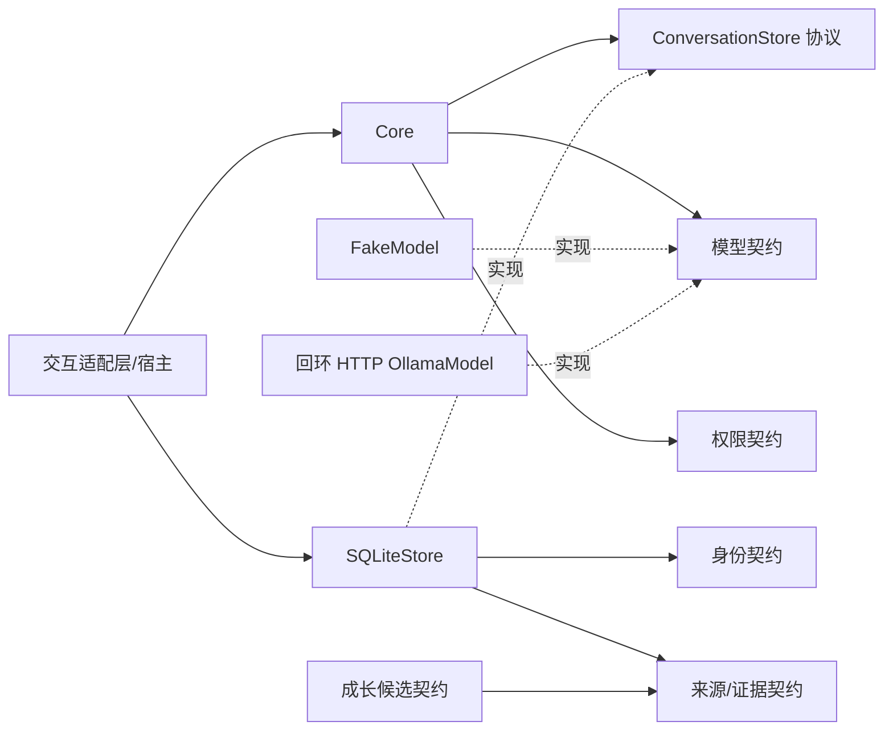

# 架构

状态：M1、M2-A 和 M2-B1 已完成内部合成验收与合并。本地候选新增桌面文字聊天、可选 `local_preview` 保存、会话恢复，以及手动备份、验证和恢复到新目录；默认仍是 FakeModel 和临时内存会话。候选的数据分类、Day 0 格式、备份格式和桌面行为与原有版本分别说明，不由历史验收推定新增测试、构建或原生窗口验收通过。正式伙伴启用、完整环境备份恢复和自动成长仍未实现。

## 形态与依赖方向

Python 模块化单体，Windows 为主，核心只使用标准库。M1 内存路径保留；持久化通过可选 `ConversationStore` 协议注入，不让 Core 导入 SQLite 实现。

| 边界 | 当前职责 | 后续职责 |
| --- | --- | --- |
| Core | 模型/策略编排，保留内存路径，可选存储协议；不可变会话/轮次 | 上下文预算、取消等 |
| Models | 同步不可变消息、完整回复、ModelError、FakeModel、非流式回环 OllamaModel/socket 超时 | 流式、取消、总时限、能力声明 |
| Storage | 合成开发或本地预览账本 UUID、Day 0、会话、输入、尝试、事件和成功轮次；短事务与一致恢复快照；本地预览数据库备份、验证及恢复候选 | schema 迁移、附件/配置和完整环境恢复另行实现 |
| Memory | 观察/推断类型、来源引用、可信登记快照、MemoryStore 协议 | 记忆记录存储、检索、修订、删除 |
| Growth | 候选及提议协议，核验独立证据根 | 人工审阅与版本化决定；无自动算法 |
| Policy | 默认仅允许 RESPOND；无授权修改器 | 校验动作参数、目标与预算 |
| Adapters | 内存/持久化合成演示、默认自建合成 HTTP 的模型演示；桌面候选的临时聊天、可选本地预览保存与显式恢复、用户触发的独立备份任务 | 语音、Live2D、游戏 |

AST 守卫覆盖 import/from-import/别名/相对导入及违规反例；领域层与模型不能依赖存储实现，Core 只引用协议，具体实现由宿主组合。静态检查和不可变对象不是针对恶意 Python 插件的安全沙箱。

## 模型与身份

`Model.generate(ModelRequest) -> ModelReply` 保持 M1 接口。请求只含伙伴/会话/输入 UUID 及不可变消息，不含数据库、策略、成长或登记表。`model_id` 是诊断信息，伙伴 UUID 不从它、设备或显卡生成。

`GenesisCore(identity, model, policy=None)` 的旧调用仍可用。存储路径为 `GenesisCore(store.identity, model, store=store)`，身份不匹配明确拒绝。SQLite 的首次初始化随机生成 UUID，之后从已有数据库加载。原有 `SQLiteStore(root)` 保留 `synthetic_development` 与 Day 0 format 1；桌面保存真实用户输入须显式采用 `local_preview` 与 Day 0 format 2，不能标作合成开发数据。预览 UUID 只表示账本连续性，不是正式伙伴初始化；仍无正式伙伴启用界面。

FakeModel 保持确定性回显/脚本响应和耗尽失败，不联网、不下载模型、没有云端回退。预期模型错误保留因果链并包装为 TurnGenerationError；意外异常及 KeyboardInterrupt 传播。数据库只记录有限错误码，不存错误正文。

OllamaModel 使用同一协议和已有文本校验，模型名精确匹配、完整 stop 响应才能成功。只发送消息与生成参数，不发送 UUID 或状态句柄。宿主组合 HTTP/Store，模型适配器不改变 Core 模型协议和 SQLite v1 物理 schema；适配器失败仍记 model_error。socket 超时不是总时限，回环不证明服务端本地推理；具体安全、失败及未来流式/取消边界见 [OLLAMA](OLLAMA.md)。

桌面候选可明确选择离线 FakeModel、本地合成 HTTP 或显式配置的本地 Ollama；真实服务须先独立核查本地运行及云功能关闭，再确认所选配置。确认框不是自动服务验证或操作系统出站保证。模型回复仅按不可信文本显示，不执行其中的工具请求。界面就绪、恢复历史或成功回执重放都不证明当前模型已被调用，详见 [DESKTOP](DESKTOP.md)。

共享 text 契约要求正文为非空白、无 NUL、可严格编码 UTF-8 的字符串。模型标识在 Core 调用模型前和存储提交入口双重校验，拒绝整数、布尔值、None、空串等，不允许 SQLite 隐式类型转换。模型回复验证失败属于契约错误，不能发布成功轮次。文本不裁剪、不替换、不归一化；具体兼容性见 PERSISTENCE。

## 会话与提交

M1 内存模式仍用 `_sessions[session_id] = new_session` 单次发布，原 57 项测试保留。它是单线程、无重入、无持久化模式。

SQLite 模式：

1. 读取成功回执。相同 `(session_id,input_id)`/内容重放，冲突明确拒绝；未知会话不自动创建。
2. 对新生成校验 RESPOND。拒绝时不接收输入或创建尝试。
3. `BEGIN IMMEDIATE`：绑定输入 ID/原文，记录宿主用户事件、尝试及基准会话版本，读取一致的历史快照，COMMIT。
4. **没有数据库事务时**执行模型。只有完整成功轮次进入历史上下文，失败用户输入仍在账本中。
5. 短事务校验尝试及版本，插入模型事件、唯一 turns 行，更新尝试与会话版本，COMMIT。turns 本身兼任回执，不维护可独立失配的成功去重表。

详细表结构、状态和重试规则见 [PERSISTENCE](PERSISTENCE.md)。模型执行不保证恰好一次；已提交结果具有幂等重放语义。输入的空格和 Unicode 原样保留。

兼容性：持久化输入一旦接收即绑定内容，模型失败也不能用同 ID 改文；内存模式未更改。跨重启重放保证值相等，不保证 Python 对象身份相等。稳定会话可通过 `store.session_ids()` 发现。公开返回值均为冻结数据类、元组或字符串，不泄漏连接/可变映射。

SQLite 连接属于一个线程；多个连接/进程由 SQLite 事务、唯一约束和会话版本防止错误提交，不依靠 Python 内存锁。竞争请求可能得到 StaleAttemptError，必须显式重试，不自动在旧上下文上提交。长会话未截断，每轮读取完整上下文；没有负载/容量基准。

桌面把存储、模型和 Core 的创建、使用及关闭放在同一工作线程，Tk 控件只由主线程操作。打开已有库只浏览会话，恢复必须选择会话 UUID，均不自动生成或重试。`recovery_snapshot(session_id)` 在同一只读事务中取得成功历史与未完成请求；重试绑定原输入 ID 和原文，旧 `running` 只表示结果未确认。正常关闭等待工作线程，致命界面错误可先销毁窗口再由工作线程收尾；都不取消已开始的模型调用，不能仅凭窗口关闭判断是否保存成功。

备份、验证与恢复由用户触发的独立任务线程执行，不跨线程借用聊天连接。备份以只读源连接调用 SQLite Online Backup；恢复只向新目录写入经验证的本地预览快照，保留身份与 Day 0，不自动打开会话或生成。正常关闭等待活动任务，不称为取消。该任务不属于模型工具权限，具体格式与失败边界见 [LOCAL_BACKUP](LOCAL_BACKUP.md)。

事务入口从无活动事务状态建立所有权，嵌套调用明确拒绝且不接管已有事务；BEGIN 位于异常保护内，刚开启后发生 KeyboardInterrupt/SystemExit 也回滚本入口拥有的活动事务。COMMIT 已完成时连接不再处于事务中，不反向回滚；返回丢失仍通过持久回执恢复。

## 证据与权限

原始用户输入由宿主登记为用户根；完整模型回复始终是模型根。`record_derived` 只接受宿主选择的已存同会话来源，继承数据库中的根；工具回显复制原文，摘要/推断固定为 model_output，没有可提交 origin/root 的参数。SQL CHECK、外键和派生来源触发器进一步约束关系。

`evidence_registry(session_id)` 从宿主事件账本生成 M1 的 TrustedEvidenceRegistry。提议引用必须与登记完整匹配，可信根也必须存在并指向自身。模型根经工具回显不成为独立用户证据，用户根经摘要保留原归属；缺失或伪造来源不计入。来源核验不证明语义、事实或偏好成立。

记录摘要/推断是宿主 API，不是让模型自主选择可信根的工具。M2-A 无外部工具根采集器、记忆检索或成长状态更新。模型自己的重复回复不会触发人格变化。存储实现不接收模型自报的 verified 标记。

默认 Policy 仍只允许回复。宿主选择的会话账本写入是 RESPOND 流程的内部持久化，不是给模型授予 WRITE_MEMORY/APPLY_GROWTH/外部动作权限。当前没有成长或外部动作执行器。

## 数据与未验证事项

数据根在仓库外。原有合成入口可采用 Windows `%LOCALAPPDATA%/Genesis` 等平台默认根；本地预览必须显式指定绝对数据根，并明确选择 `create` 或 `open`，不会由默认目录悄悄启用保存。原合成文件为 `genesis-synthetic.sqlite3`（GEN1，`application_id=0x47454E31`）；预览使用独立目录下的 `genesis-local-preview.sqlite3`（GLP1，`application_id=0x474C5031`）。两者均沿用物理 schema / `user_version=1`，不能混放、改名转换或迁移旧合成数据。具体初始化边界见 [LOCAL_PREVIEW](LOCAL_PREVIEW.md)。

现有损坏、未知 schema 或不一致 Day 0 明确报错，不重建或覆盖。预览 `open` 不创建缺失目录、数据库或替代身份；打开已有合法数据库时仍可能发生 SQLite 热日志恢复，因此不是文件系统级只读操作，也不等于从备份恢复。

Day 0 包含规范初始状态、环境版本和 SHA-256；哈希不提供身份认证或可信时间证明。预览会明文保存已接收输入（包括失败和未完成请求）、已提交回复及执行状态，新的数据库备份候选也保留这些内容；清空界面或关闭窗口不删除账本及备份。快照、version 1 清单和永久保留的普通空初始化锁文件组成最小备份产物，不包含模型权重、配置、未发送草稿或完整运行环境。备份与数据库首次创建共用仲裁，防止合作的创建者误把备份目录用作新账本；空锁文件存在不表示占用。隐私删除、加密、schema 升级与分叉合并均未实现；不能把活跃数据库主文件的普通复制宣传为一致备份，也不能把聊天保存或备份称为长期记忆或成长。

原有 M2-A 验收覆盖合成本地数据库与独立进程中断；这些历史记录不代替新增预览分类和桌面候选的独立验证。真实磁盘断电、磁盘耗尽、硬件故障、长期规模、多客户端负载以及真实模型和 GPU 性能仍需各自验收。原生窗口布局与真实模态交互不能由无窗口回归推出，详见 [DESKTOP](DESKTOP.md) 和 [DATA_PORTABILITY](DATA_PORTABILITY.md)。
